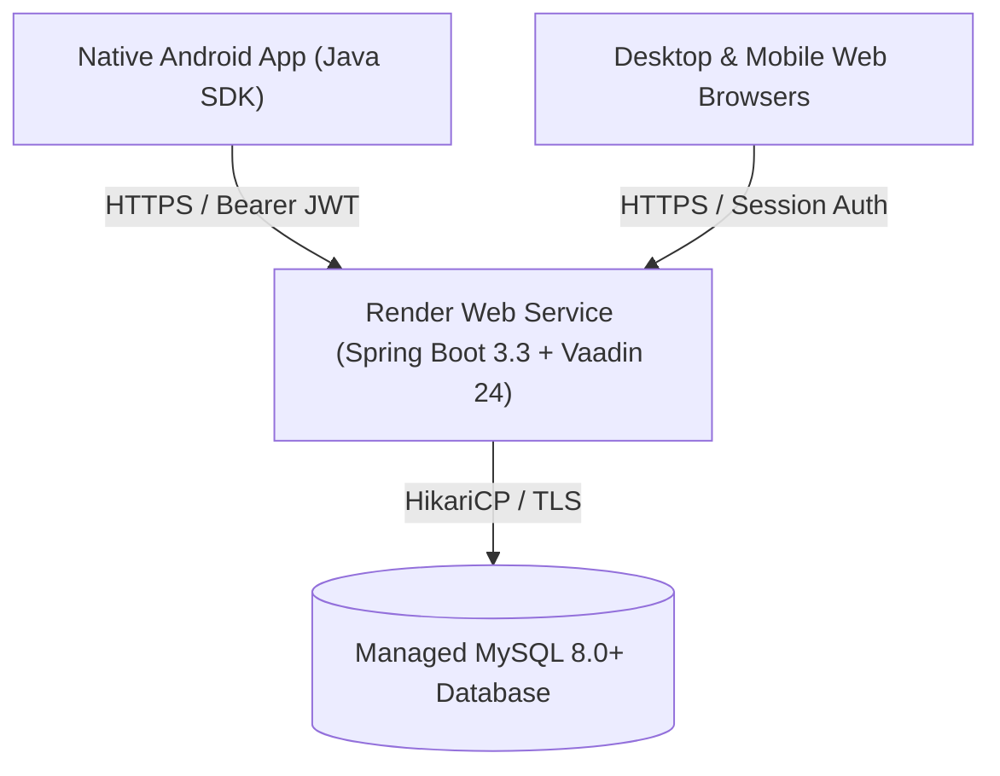

# HER HEALTH JOURNEY – Production Deployment Guide

## 1. Architecture Overview

HER HEALTH JOURNEY is deployed as a containerized web service on **Render**, backed by a managed external **MySQL** database.

---

## 2. Environment Variables Specification

Set the following environment variables in the Render Dashboard (**Environment** tab):

| Variable | Type | Value / Description | Example |
|---|---|---|---|
| `SPRING_PROFILES_ACTIVE` | String | Sets production configuration | `prod` |
| `DB_URL` | String | JDBC connection string to managed MySQL | `jdbc:mysql://your-mysql-host.render.com:3306/her_health?sslMode=VERIFY_IDENTITY` |
| `DB_USERNAME` | String | MySQL database user | `her_health_admin` |
| `DB_PASSWORD` | Secret | Strong database password | `****************` |
| `JWT_SECRET` | Secret | Minimum 256-bit secret key for token signing | `8f4b23c9a1d4e7f82b3c4d5e6f7a8b9c0d1e2f3a4b5c6d7e8f9a0b1c2d3e4f5` |
| `PORT` | Integer | Injected by Render dynamically | `8080` (Default) |

---

## 3. Render Deployment Steps

1. **Connect GitHub Repository**:
   - In Render, click **New +** → **Web Service**.
   - Select the `HER_HEALTH_JOURNEY` repository.

2. **Configure Service**:
   - **Name**: `her-health-journey`
   - **Root Directory**: `backend`
   - **Environment**: `Docker`
   - **Branch**: `main`
   - **Instance Type**: Starter / Standard

3. **Add Environment Variables**:
   - Add `SPRING_PROFILES_ACTIVE=prod`, `DB_URL`, `DB_USERNAME`, `DB_PASSWORD`, `JWT_SECRET`.

4. **Health Check Configuration**:
   - Set **Health Check Path** to `/api/health`.

5. **Deploy**:
   - Click **Create Web Service**.
   - Render will build the multi-stage Dockerfile and start the application.

---

## 4. Verification Checklist

- [x] `GET https://<your-render-url>/api/health` returns `{"status":"UP","application":"HER HEALTH JOURNEY"}`.
- [x] Flyway migrations execute automatically on startup and create all 7 tables.
- [x] Vaadin Web UI is reachable at `https://<your-render-url>/`.
- [x] Swagger UI is accessible at `https://<your-render-url>/swagger-ui.html`.
- [x] Android mobile application successfully logs in against the production URL.

